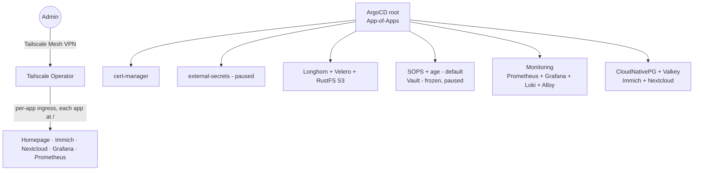

# GitOps Platform

[](https://kubernetes.io/)
[](https://argoproj.github.io/cd/)
[](./docs/sops.md)
[](https://tailscale.com/)

[](./docs/roadmap.md#what-blocks-v100)
[](https://github.com/Seom88/gitops-platform/actions)
[](https://github.com/Seom88/gitops-platform/commits)
[](LICENSE)

A production-style GitOps platform running real workloads on Kubernetes — zero-trust access, encrypted secrets, observable storage and backups. All declarative, all in git.

> If you hire platform engineers: this repo is the proof. Design docs, tradeoffs, and running code — not slides.

## In 30 seconds

- **What it is:** App-of-Apps GitOps layer on top of any CNCF Kubernetes cluster (ArgoCD pre-installed). One command bootstraps networking, storage, observability, secrets and apps.
- **What it runs today:** Homepage, Immich (photos on CloudNativePG), Nextcloud (files on CloudNativePG + shared Valkey cache), Prometheus + Grafana + Loki, Longhorn, Velero backups to S3.
- **How it's secured:** Tailscale per-app ingress (no public ports), SOPS + age encrypted secrets in git, Cilium network policies, Trivy + secret scanning in CI.
- **Release state:** v1.0 scope is deployed and working. Manual Velero restore tested Oct 2026; formal clean-cluster drill deferred to v2.0. Single source of truth: [`docs/roadmap.md`](./docs/roadmap.md).

## How it fits together



> Networking detail: Cilium 1.20.1 eBPF + Gateway API. See [ADR-014](./docs/adrs/014-cilium-cni-and-identity-networkpolicies.md) and [Networking](./docs/networking.md).

## What this proves I can do

| You need | Proof here |
|----------|------------|
| **Ship GitOps, not YAML soup** | ArgoCD App-of-Apps with sync-wave ordering and custom health checks — [`gitops/templates/`](./gitops/templates/), [ADR-006](./docs/adrs/006-app-health-and-vault-ordering.md) |
| **Handle secrets like prod** | SOPS + age as default path (encrypted in git, applied via `just secrets-apply`); Vault built, frozen and paused by decision — [ADR-017](./docs/adrs/017-vault-paused-sops-default.md), [`docs/sops.md`](./docs/sops.md) |
| **Zero-trust networking** | Tailscale operator, one MagicDNS device per app, Cilium policies per namespace — [ADR-018](./docs/adrs/018-per-app-tailscale-ingress.md) |
| **Own data durability** | Longhorn block + external RustFS S3, Velero daily backups, manual restore already executed — [`docs/cluster-recovery.md`](./docs/cluster-recovery.md) |
| **Be honest about HA** | Pod-level HA (PDBs, multi-replica stateless, snapshots + off-cluster backups). Single-node cluster = node failure is total downtime — [ADR-019](./docs/adrs/019-single-node-bare-metal-migration.md) |
| **Operate it** | Prometheus + Grafana + Loki + Alloy, CI lint/render/scan gates, Renovate weekly updates — [`docs/ci-cd.md`](./docs/ci-cd.md) |

Full breakdown: [`docs/skills-demonstrated.md`](./docs/skills-demonstrated.md) · Decisions: [`docs/adrs/`](./docs/adrs/)

## Tech stack

| Layer | Component | State |
|-------|-----------|-------|
| Orchestration | Kubernetes 1.27+ (any distro), ArgoCD 2.8+ pre-installed | Ready |
| Secrets | SOPS + age (default) · Vault v1.15+ (frozen, disabled by default) | Deployed / Paused |
| Networking | Cilium 1.20.1 eBPF, Tailscale Operator, cert-manager | Deployed |
| Storage | Longhorn v1.6+, RustFS S3 external (`loki`, `velero-homelab` buckets) | Deployed |
| Data | CloudNativePG, Valkey shared cache | Deployed |
| Apps | Homepage, Immich, Nextcloud | Deployed |
| Observability | Prometheus + Grafana + Loki + Alloy DaemonSet, Trivy Operator | Deployed |
| Backups | Velero 1.18.2 — daily schedules, manual restore verified | Backup OK · formal drill → v2.0 |

## Run it

Assumes a running cluster with ArgoCD already installed. Cluster provisioning is out of scope.

```bash
# 1. Clone and configure
git clone https://github.com/Seom88/gitops-platform.git
cd gitops-platform
cp .env.example .env  # fill in Tailscale + S3 keys — or: just secrets-init

# 2. Bootstrap (idempotent — safe to rerun)
just init-prod   # prod — or: just init-dev

# 3. Check health
just status
kubectl get applications -n argocd

# 4. Open dashboards (via Tailscale, or port-forward locally)
kubectl port-forward -n monitoring svc/grafana 3000:80
```

Full walkthrough: [`docs/getting-started.md`](./docs/getting-started.md) · Forking it: [`docs/customization-guide.md`](./docs/customization-guide.md)

Requirements: Kubernetes 1.27+, ArgoCD 2.8+, kubectl, helm 3.12+, [just](https://github.com/casey/just), Tailscale account (free tier works).

## Project structure

```
gitops-platform/
├── bootstrap/       # init-gitops.sh — idempotent GitOps bootstrap
├── gitops/          # Root App-of-Apps chart (values.yaml + values-dev.yaml)
├── platform/        # First-party charts: vault, monitoring, ts-operator,
│                    #   longhorn, velero, valkey, trivy-operator, s3-bucket-lib
├── apps/            # homepage, immich, nextcloud
├── docs/            # guides + adrs/ (24 decisions and counting)
├── .github/workflows/ # ci.yaml (lint+scan) — CI never touches the cluster; deploys are ArgoCD pull
├── justfile         # init-prod/dev, secrets-apply, validate, scan, status
├── renovate.json    # weekly dependency updates
└── CHANGELOG.md     # release history
```

## Roadmap & status

v1.0 scope is **deployed** — not tagged yet. Nothing open except the tag itself; formal restore drill moved to v2.0.

| Phase | Status |
|-------|--------|
| Phase 1 — Foundation (bootstrap, ArgoCD, TLS, Tailscale, ADRs) | ✅ Complete |
| Phase 2 — Automation & Observability (monitoring, CI/CD, Renovate) | ✅ Complete |
| Phase 3 — Storage & Scale (Longhorn, RustFS, Velero backup + manual restore) | ✅ Complete |
| Phase 4 — Hardening & DX (Trivy, secret scan, SOPS-default, real apps) | ✅ Complete |
| Phase 5 — Python ops layer | → v2.0 |

Details: [`docs/roadmap.md`](./docs/roadmap.md)

## Docs

- [Getting Started](./docs/getting-started.md) — end-to-end bootstrap
- [Features Deep Dive](./docs/features-deep-dive.md) — system design per component
- [CI / CD](./docs/ci-cd.md) — pipelines, gates, local mirrors
- [Networking](./docs/networking.md) — Cilium, Gateway API, policies
- [SOPS + age](./docs/sops.md) — default secrets workflow
- [Cluster Recovery](./docs/cluster-recovery.md) — backup & restore runbook
- [Customization](./docs/customization-guide.md) — fork and adapt
- [Devcontainer](./docs/devcontainer.md) — isolated AI agent environment
- [ADRs](./docs/adrs/) — why each key decision was made

## Work with me

Found a bug? → [Issues](https://github.com/Seom88/gitops-platform/issues) · Have an idea? → [Discussions](https://github.com/Seom88/gitops-platform/discussions) · Proof of skills → [`docs/skills-demonstrated.md`](./docs/skills-demonstrated.md) · Reach me → [GitHub @Seom88](https://github.com/Seom88)

---
⭐ If this saved you time, a star helps more than you think.
